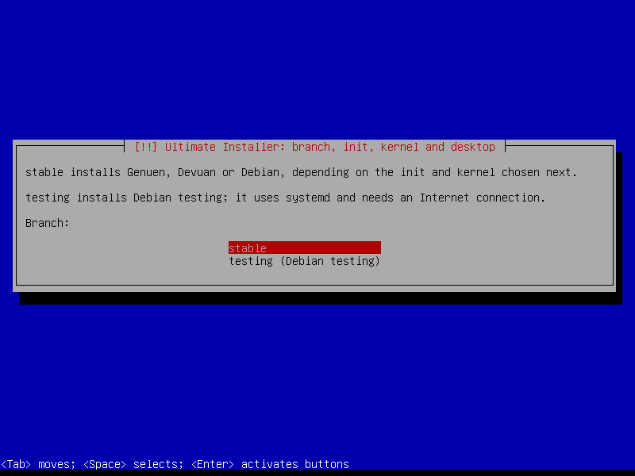
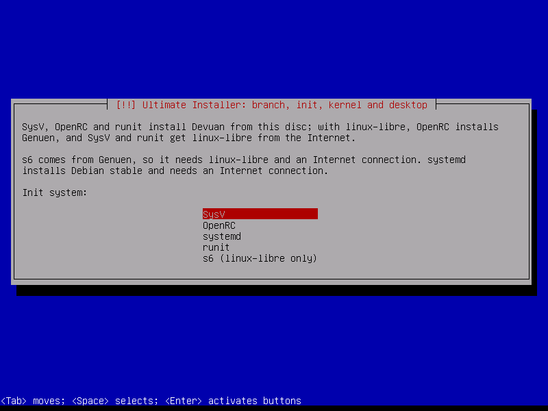
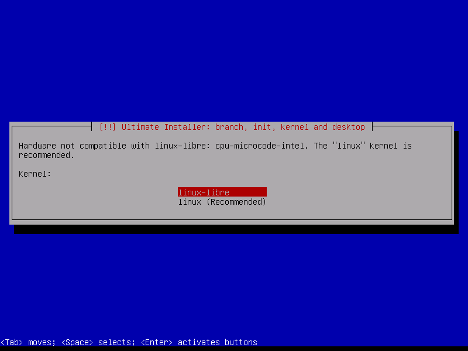
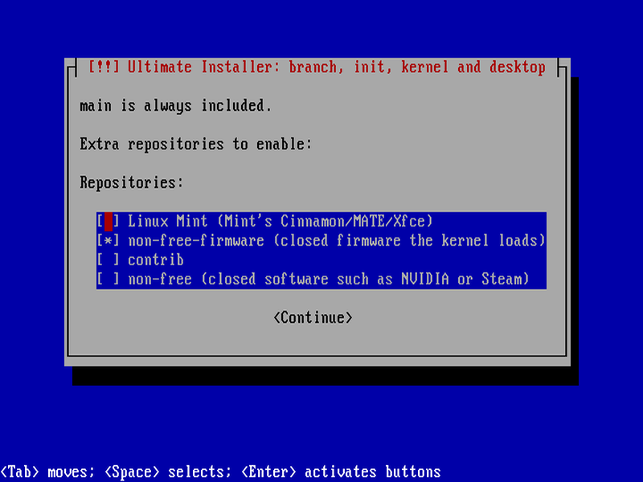
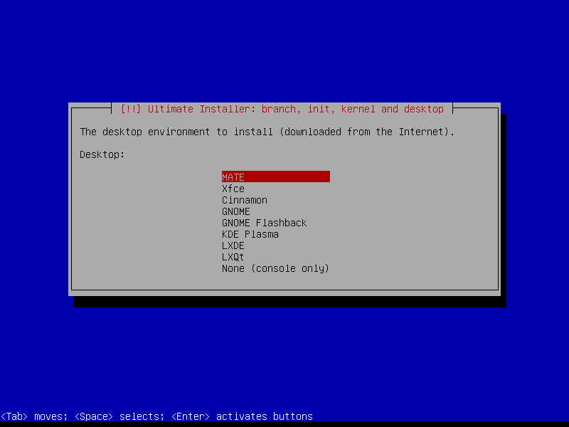
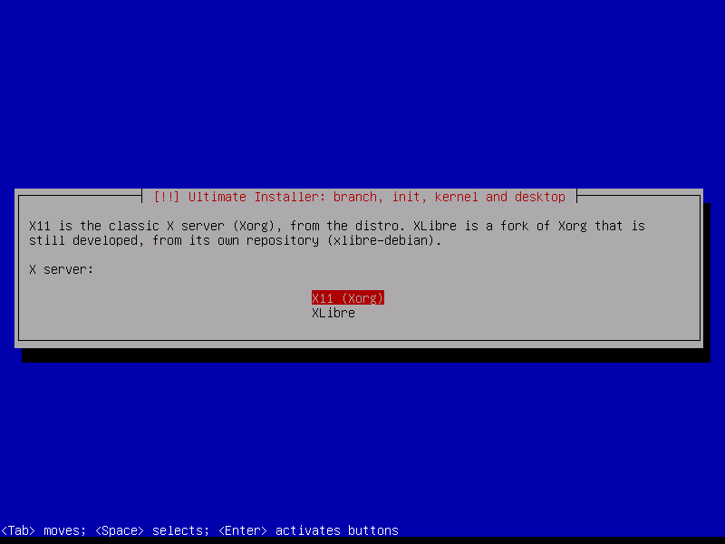

# Ultimate Installer

Not a distro: one Debian/Devuan netinstall ISO that installs the existing
Devuan/Debian-family distro that your choices add up to, with that distro's own
packages and repositories. It is the stock Debian/Devuan installer
(debian-installer, text mode, as Devuan ships it) with a few extra screens.

## Screenshots

The screens Ultimate Installer adds to the stock installer:

| | |
|---|---|
|  |  |
| Branch: stable or testing | Init system |
|  |  |
| Kernel, with a warning about hardware that needs closed firmware | Extra repositories (not with linux-libre) |
|  |  |
| Desktop | X server, only for X11 desktops |

## What gets installed

| Branch | Init | Kernel | Installs |
|---|---|---|---|
| stable (Default) | SysV (Default), runit | linux-libre (Default) | **Devuan** + linux-libre |
| stable | OpenRC | linux-libre | **Genuen** (libre Devuan) |
| stable | s6 | linux-libre only | **Genuen** with s6 |
| stable | SysV, OpenRC, runit | linux (Recommended) | **Devuan** |
| stable | systemd | linux | **Debian** stable |
| stable | systemd | linux-libre | **Debian Libre** (Debian main + linux-libre) |
| testing | systemd | linux-libre / linux | **Debian testing** |

- **Kernel**: linux-libre is fully free; "linux" is recommended so closed
  firmware (Wi-Fi, graphics…) works. The screen tells you if your hardware
  needs it.
- **Repositories**: with linux-libre, `main` only. With "linux", `main` plus
  `non-free-firmware`, `contrib` and `non-free` to choose from: on stable only
  `non-free-firmware` comes ticked; on testing all three do (untick what you
  don't want).
- **Desktop**: MATE (Default), Xfce, Cinnamon, GNOME, GNOME Flashback,
  KDE Plasma, LXDE, LXQt or none.
- **X server**: for X11 desktops, X11 (Xorg, Default) or
  [XLibre](https://github.com/X11Libre/xserver). Plasma and GNOME use Wayland.
- One kernel in the installed system; closed firmware can be added or removed
  later with `ultimate-firmware`.

"Install" skips the boring questions (domain, mirror, proxy, GRUB disk…);
"Expert install" asks everything.

## Versions
Ultimate 1.x follows Devuan 6.x: Devuan 6.1 = Ultimate 1.1. Our own fixes on
the same Devuan base are 1.1.1, 1.1.2…

## Build
    ./build-iso.sh devuan_excalibur_6.1.1_amd64_netinstall.iso \
        genuen-6.0.1-netinstall-2026.10.11-amd64.iso out/ultimate-installer.iso

## Credits
Ultimate Installer only puts together the work of these projects:
- [Genuen](https://genuen.org) — libre spin of Devuan
- [Devuan](https://devuan.org) — Debian without systemd, and its installer
- [Debian](https://www.debian.org) — the base of everything, and debian-installer
- [Debian Libre](https://libre.debian.net) — the idea of Debian without non-free
- [XLibre](https://github.com/X11Libre/xserver) and its Debian packages,
  [xlibre-debian](https://xlibre-debian.github.io) (NexusSfan)
- [GNU Linux-libre / FSFLA freesh](https://www.fsfla.org/ikiwiki/selibre/linux-libre/freesh)

## License
GPL-3.0-or-later (see `LICENSE`). debian-installer, which this builds on, is
GPL-2.0-or-later.
